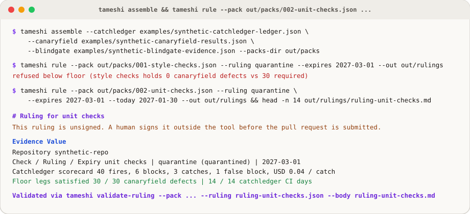
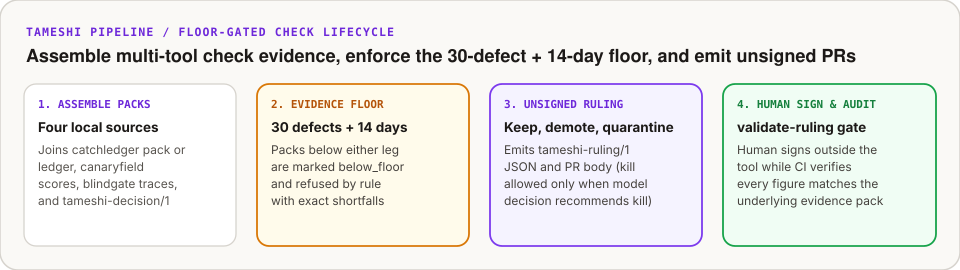
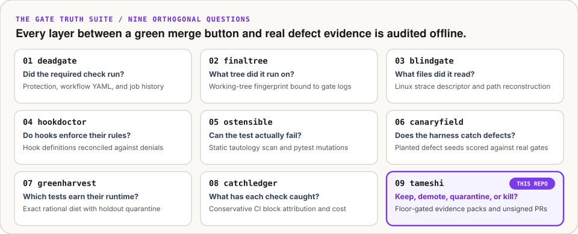

<p align="center">
  <a href="https://github.com/david-engelmann/tameshi">
    <picture>
      <source media="(prefers-color-scheme: dark)" srcset="https://raw.githubusercontent.com/david-engelmann/tameshi/main/docs/media/tameshi-lockup-dark.svg">
      
    </picture>
  </a>
</p>

<p align="center">
  <a href="https://github.com/david-engelmann/tameshi/blob/main/docs/GUIDE.md"><b>Operator Guide</b></a> |
  <a href="https://david-engelmann.github.io/tameshi/">Published Docs</a> |
  <a href="https://github.com/david-engelmann/tameshi/tree/main/examples">Examples</a> |
  <a href="https://github.com/david-engelmann/tameshi/blob/main/docs/ARCHITECTURE.md">Architecture</a> |
  <a href="https://github.com/david-engelmann/tameshi/blob/main/docs/FORMATS.md">Wire Formats</a> |
  <a href="https://github.com/david-engelmann/tameshi/blob/main/docs/PERFORMANCE.md">Performance</a> |
  <a href="https://david-engelmann.github.io/tameshi/api/tameshi/index.html">Rust API</a> |
  <a href="https://github.com/david-engelmann/tameshi/blob/main/docs/COMPARISON.md">Comparison</a> |
  <a href="https://github.com/david-engelmann/tameshi/blob/main/docs/FAQ.md">FAQ</a> |
  <a href="https://github.com/david-engelmann/tameshi/releases">Releases</a>
</p>

<p align="center">
  <a href="https://github.com/david-engelmann/tameshi/actions/workflows/ci.yml"></a>
  <a href="https://david-engelmann.github.io/tameshi/"></a>
  <a href="https://github.com/david-engelmann/tameshi/blob/main/Cargo.toml"></a>
  <a href="https://github.com/david-engelmann/tameshi/blob/main/LICENSE"></a>
</p>

# tameshi

The evidence pack tool for checks, where catch record, canary performance, false block rate, cost per catch, and blindness traces are assembled into one evidence pack per check and the ruling is issued as a pull request.

<p align="center">
  <picture>
    <source media="(prefers-color-scheme: dark)" srcset="https://raw.githubusercontent.com/david-engelmann/tameshi/main/docs/media/terminal-showcase-dark.svg">
    
  </picture>
</p>

## What this is

Checks have no lifecycle in mainstream tooling. A check is required or it is absent, with no evidenced path through advisory, probation, and quarantine with expiry, so rational teams keep everything forever and suites grow into an hour of tests that stop nothing. Tameshi assembles the evidence the gate instruments produce and rules on it, keep, demote to advisory, or quarantine with a date. Nothing is deleted by the tool, rulings stay human signed, and a check can win a stay by producing fresh evidence. The boundary with its sibling is one sentence. Tameshi judges checks, verdictloop judges changes.

<p align="center">
  <picture>
    <source media="(prefers-color-scheme: dark)" srcset="https://raw.githubusercontent.com/david-engelmann/tameshi/main/docs/media/how-it-works-dark.svg">
    
  </picture>
</p>

## Install

Install directly from this GitHub repository with Cargo (Rust `1.61` or newer on Linux and macOS), install checksum-verified prebuilt archives via `install.sh`, or download prebuilt archives via `cargo-binstall --git` once prebuilt release archives are attached (`v0.34.0` and `v0.35.0` onward). Do **not** run bare `cargo install tameshi` from `crates.io`, because the `tameshi` name on `crates.io` belongs to an unrelated third-party library.

```sh
cargo install --git https://github.com/david-engelmann/tameshi --locked
```

```sh
curl -fsSL https://raw.githubusercontent.com/david-engelmann/tameshi/main/install.sh | sh
export PATH="$HOME/.local/bin:$PATH"
cargo binstall --git https://github.com/david-engelmann/tameshi tameshi
```

## Quickstart

Assemble per-check evidence packs from `examples/`, generate an unsigned quarantine ruling for `unit checks` (which meets both the 30-defect `canaryfield` floor and the 14-day `catchledger` floor), and validate the ruling against its pack.

```sh
git clone https://github.com/david-engelmann/tameshi.git
cd tameshi
mkdir -p /tmp/tm-demo/packs /tmp/tm-demo/rulings

tameshi assemble \
  --catchledger examples/synthetic-catchledger-ledger.json \
  --canaryfield examples/synthetic-canaryfield-results.json \
  --blindgate examples/synthetic-blindgate-evidence.json \
  --packs-dir /tmp/tm-demo/packs

tameshi rule \
  --pack /tmp/tm-demo/packs/002-unit-checks.json \
  --ruling quarantine \
  --expires 2027-03-01 \
  --today 2027-01-30 \
  --out /tmp/tm-demo/rulings

tameshi validate-ruling \
  --pack /tmp/tm-demo/packs/002-unit-checks.json \
  --ruling /tmp/tm-demo/rulings/ruling-unit-checks.json \
  --body /tmp/tm-demo/rulings/ruling-unit-checks.md
```

```markdown
# Ruling for unit checks

The evidence pack for this check has been assembled and stands at or above the evidence floor on both legs. The ruling below is issued from that pack and every number in the receipts is read from it.

This ruling is unsigned. A human signs it outside the tool before the pull request is submitted, and nothing is deleted by this ruling.

| Evidence | Value |
| --- | --- |
| Repository | synthetic-repo |
| Check | unit checks |
| Ruling | quarantine |
| State after ruling | quarantined |
| Expiry | 2027-03-01 |
| Fires | 40 |
| Blocks | 6 |
| Catches | 3 |
| False blocks | 1 |
| Unattributed blocks | 2 |
| False block rate | 0.166667 |
| Runtime seconds | 900 |
| Total cost USD | 0.12 |
| Cost per catch USD | 0.04 |
| Canary scored defects | 30 |
| Canary caught | 30 |
| Canary waved through | 0 |
| Canary gate broken | 0 |
| Canary not applicable | 0 |
| Canary catch rate | 1.0 |
| Canary defects held | 30 |
| Canary defects required | 30 |
| CI history days held | 14 |
| CI history days required | 14 |
| Blindness traces | 1 |
```

By contrast, `001-style-checks.json` holds `0` scored `canaryfield` defects (`30` required), so `tameshi assemble` marks `"below_floor": true` (`canary_shortfall: 30`) and `tameshi rule` refuses to issue a ruling on it.

## Verification and Footprint

Run the full local gate on Linux (and package/lint checks on Linux or macOS).

```sh
cargo test --locked
cargo fmt --check
cargo clippy --offline --all-targets
cargo package --locked
```

| Property | Value |
| --- | --- |
| External crate dependencies | `0` (`std` only) |
| Minimum Supported Rust Version | `1.61` |
| Release binary size (`aarch64-apple-darwin`) | `747.0 KiB` |
| Mandatory evidence floor | `30` scored canary defects + `14` CI days |
| Network calls or file deletions | `0` |

## The Gate Truth Suite

<p align="center">
  <picture>
    <source media="(prefers-color-scheme: dark)" srcset="https://raw.githubusercontent.com/david-engelmann/tameshi/main/docs/media/gate-truth-arc-dark.svg">
    
  </picture>
</p>

| Tool | Question answered | Primary evidence |
| --- | --- | --- |
| [deadgate](https://github.com/david-engelmann/deadgate) | Did the required check actually run? | Branch protection, workflow YAML, and job history |
| [finaltree](https://github.com/david-engelmann/finaltree) | What exact tree did the gate run on? | Working-tree SHA-256 fingerprint bound to stamped logs |
| [blindgate](https://github.com/david-engelmann/blindgate) | What files did the gate actually read? | Linux `strace` descriptor and path reconstruction |
| [hookdoctor](https://github.com/david-engelmann/hookdoctor) | Do hooks enforce their declared rules? | Hook definitions reconciled against execution denials |
| [ostensible](https://github.com/david-engelmann/ostensible) | Can the test actually fail? | Static tautology scan and `pytest` mutations |
| [canaryfield](https://github.com/david-engelmann/canaryfield) | Does the harness catch planted defects? | Seeded defect classes scored across real gates |
| [greenharvest](https://github.com/david-engelmann/greenharvest) | Which tests earn their CI runtime? | Exact rational value ranking and reversible quarantine |
| [catchledger](https://github.com/david-engelmann/catchledger) | What has each check caught, and at what cost? | Conservative post-block Git DAG attribution and USD cost |
| [tameshi](https://github.com/david-engelmann/tameshi) | Keep, demote, quarantine, or kill this check? | 30-defect and 14-day floor-gated unsigned ruling PRs |

## Documentation

| If you want to... | Read |
| --- | --- |
| Browse the searchable handbook with diagrams | [Published documentation](https://david-engelmann.github.io/tameshi/) |
| Assemble packs, sign rulings outside the tool, and run CI gates | [Operator Guide](https://github.com/david-engelmann/tameshi/blob/main/docs/GUIDE.md) |
| Understand multi-source floor accounting and `tameshi-pack/2` decisions | [Architecture](https://github.com/david-engelmann/tameshi/blob/main/docs/ARCHITECTURE.md) |
| Integrate `tameshi-pack/1,2`, `tameshi-decision/1`, and `tameshi-ruling/1` | [Wire Formats](https://github.com/david-engelmann/tameshi/blob/main/docs/FORMATS.md) |
| Compare `tameshi` against static branch protection and `verdictloop` | [Comparison](https://github.com/david-engelmann/tameshi/blob/main/docs/COMPARISON.md) and [FAQ](https://github.com/david-engelmann/tameshi/blob/main/docs/FAQ.md) |
| Review threat boundaries, vulnerability reporting, and contribution gates | [Security Policy](https://github.com/david-engelmann/tameshi/blob/main/SECURITY.md) and [Contributing](https://github.com/david-engelmann/tameshi/blob/main/CONTRIBUTING.md) |

## Status

- Slice 2 is built and proven on synthetic targets only
- Slice 2 assembles one evidence pack per check in the format tameshi-pack/1 from a catchledger pack or ledger, reading canaryfield results directly or from the pack and blindness traces where blindgate evidence is supplied
- Slice 2 accounts every pack against the evidence floor of 30 canaryfield-scored planted defects and 14 days of catchledger CI history, read as the span of each check own catch record timestamps, and marks a pack below the floor
- Slice 2 generates the ruling pull request for a pack at or above the floor as a local ruling record in the format tameshi-ruling/1 and a body whose numbers all come from the pack, refuses a ruling below the floor naming each failed leg and its shortfall, and emits unsigned records only
- Slice 2 is the Round 1 work increment and is built on a local branch, and the round closes only after audit and two-axis review and red team and owner approval
- Round 2 completes the rename from keeporkill to tameshi across the tree, refuses any JSON document that carries the same key twice in one object under obligation TM2-2, and opens the Rust port with slice 1 under obligations PORT-1 to PORT-6, carrying the rendering and the document reader and the pack assembly and the ruling generation into a standard library only crate proven by fifty one recorded conformance cases against the landed Python, with the catchledger document reading and the command line staying Python in this slice for the reasons the contract states
- Round 3 opens the second Rust port slice under obligations PORT2-1 to PORT2-6, carrying the catchledger document reading whole into the crate, the pack and ledger validation and the ledger derivation under the read entry the pack assembly stands on, proven by one hundred further recorded conformance cases against the landed Python, and the slice is built on a local branch and the round closes only after audit and two-axis review and red team and owner approval, with the command line and the package front doors staying Python for the reasons the contract states
- Round 6 lands slice 4, the ruling record validation, reading a ruling record back against the pack it was ruled from and refusing it when any field the pack decides stands unfaithful, through a library reading and a fourth door, with the signature block read for shape and consistency alone because rulings stay human signed
- Round 5 lands slice 3, the decision record and the kill ruling, carrying a recorded decision model recommendation into the pack as tameshi-pack/2 and issuing a kill ruling only above the floor on a pack that recommends it, with one live decision run over a synthetic pack standing in the examples
- Round 4 closes the Rust port under obligations PORT3-1 to PORT3-6, carrying the command line whole into the binary with the three doors the Python carried and retiring the Python package and suite from the tree, the recorded battery and the earlier recordings standing as the specification from here on, with the reader bound standing as a stated port limit in the one band the round's probes found the Python completing past it
- Closed rounds stand at 37 of 100
- Seeded in October 2026. Part of the impatient programming portfolio, in the Gate Truth arc

## Licence

MIT. See LICENSE.
