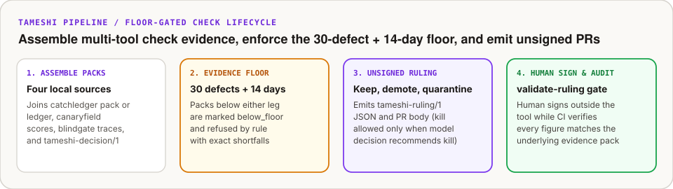

# Tameshi Architecture

Tameshi judges checks by assembling multi-instrument Gate Truth evidence (`catchledger`, `canaryfield`, `blindgate`, and optional `tameshi-decision/1` records) into per-check packs, enforcing a hard two-leg evidence floor, and generating unsigned lifecycle rulings as pull-request artifacts. Implemented as a zero-dependency pure-Rust library (`src/lib.rs`) and CLI (`src/main.rs`), Tameshi makes zero network calls and deletes nothing on disk.

  <picture>
    <source media="(prefers-color-scheme: dark)" srcset="https://raw.githubusercontent.com/david-engelmann/tameshi/main/docs/media/how-it-works-dark.svg">
    
  </picture>

## Pipeline Stages

### 1. Strict JSON and Multi-Source Ingestion (`src/jsonvalue.rs`, `src/reader.rs`, `src/ingest.rs`)

All input documents pass through Tameshi's pure-Rust JSON parser, refusing duplicate object keys at every depth and bounding nesting at `4000`. `tameshi assemble` accepts either a single-check `catchledger-pack/1` document or a multi-check `catchledger-ledger/1` document, validates its scorecard arithmetic and ISO-8601 timestamps from first principles, and joins matching `canaryfield` defect outcomes, `blindgate-evidence/1` blindness traces, and optional `tameshi-decision/1` model recommendations.

### 2. Two-Leg Evidence Floor Accounting (`src/packs.rs`)

Every assembled pack (`tameshi-pack/1` or `tameshi-pack/2`) computes floor standing across two independent legs

1. **Planted sensitivity leg** Counts `canaryfield` outcomes in `caught`, `waved-through`, `gate-broken`, and `timed-out` (`not-applicable` excluded) against the `30` scored-defect minimum.
2. **Historical CI span leg** Computes the UTC calendar span across the check's own `catch_record` entries from `catchledger` against the `14` day minimum (preventing a wide repository history window from disguising a brand-new check).

Packs failing either leg still assemble with `"below_floor": true` (`"meets_floor": false` inside `floor`) so operators can inspect exact shortfalls.

### 3. Floor-Gated Unsigned Ruling Generation (`src/rulings.rs`, `src/render.rs`)

`tameshi rule` refuses any `below_floor` pack, naming each failed leg and its numerical shortfall. Above the floor, it emits `ruling-<slug>.json` (`tameshi-ruling/1`) with `"signature": {"status": "unsigned", "signed_by": null, "signed_at": null}` alongside `ruling-<slug>.md` carrying a deterministic 25-row receipt table (plus decision rows on `tameshi-pack/2`). By contract, `kill` rulings require a `tameshi-pack/2` pack whose embedded `recommendation.recommendation` equals `"kill"`.

### 4. First-Principles Revalidation (`validate` and `validate-ruling`)

`tameshi validate` rebuilds the expected pack from raw inputs and checks structural JSON equality, while `tameshi validate-ruling` verifies every `repo`, `check`, `floor`, `ruling`, `state_after_ruling`, `expiry`, and optional `recommendation` field in `ruling-<slug>.json` (and exact byte identity on optional `--body` Markdown) against the source pack while checking `signature` block consistency (`status: "unsigned"` with `null` signer fields, or `status: "signed"` with non-empty `signed_by` and `signed_at`).

## Packaging and Runtime Footprint

- **External Rust dependencies** `0` (`std` only)
- **Minimum Supported Rust Version** `1.61`
- **Network calls or file deletions** `0`
- **Release binary size (`aarch64-apple-darwin`)** `747.0 KiB`
- **Parser nesting bound** `4000`
