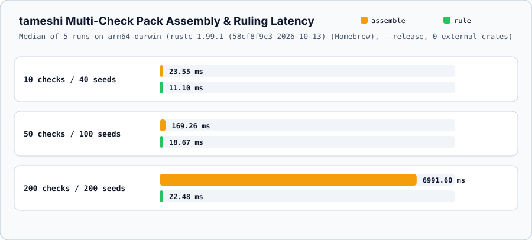

# Tameshi Performance and Footprint

Tameshi runs completely in-process with zero external crates, zero network calls, and zero subprocess invocations. Pack assembly normalizes `catchledger`, `canaryfield`, `blindgate`, and `tameshi-decision/1` documents, verifies cross-source agreement, computes two-leg floor accounting (`30` planted defects and `14` UTC days), and renders deterministic JSON packs and Markdown pull-request receipts.

<p align="center">
  <picture>
    <source media="(prefers-color-scheme: dark)" srcset="https://raw.githubusercontent.com/david-engelmann/tameshi/main/docs/media/benchmark-chart-dark.svg">
    
  </picture>
</p>

## Measured Synthetic Benchmarks

Measured over five timed iterations (after warm-up) on `arm64-darwin` with `rustc 1.99.1 (58cf8f9c3 2026-10-13) (Homebrew)` against the `--release` `tameshi` binary.

| Synthetic workload | Check-seed evaluations | `tameshi assemble` median | `tameshi rule` (per check) median |
| --- | ---: | ---: | ---: |
| `10` checks / `40` planted seeds | `400` | `23.55 ms` | `11.10 ms` |
| `50` checks / `100` planted seeds | `5,000` | `169.26 ms` | `18.67 ms` |
| `200` checks / `200` planted seeds | `40,000` | `6991.60 ms` | `22.48 ms` |

## Scaling Characteristics and Resource Bounds

- **Pack assembly (`src/packs.rs`)** `tameshi assemble` normalizes and validates the `canaryfield` gate matrix independently per check (`O(C^2 * S)` across `C` checks and `S` planted seeds) and writes numbered `<NNN>-<slug>.json` files in sorted check order.
- **Constant-time per-check ruling and validation (`src/rulings.rs`)** `tameshi rule` and `tameshi validate-ruling` inspect a single check's assembled pack, completing in `11` to `23` milliseconds regardless of total repository check count.
- **Parser recursion bound (`src/jsonvalue.rs`)** JSON nesting depth is bounded at `4000` levels with strict duplicate-key refusal at every object level.
- **Binary footprint** `747.0 KiB` `--release` binary (`aarch64-apple-darwin`) with `0` external Rust dependencies.

## Reproducing Locally

Run the self-contained synthetic benchmark harness from a repository checkout.

```sh
cargo build --release --locked
python3 scripts/bench.py --bin target/release/tameshi
```
