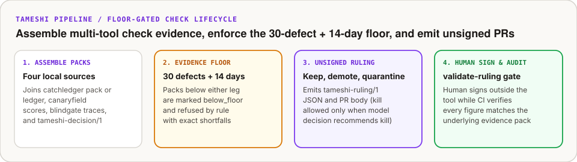
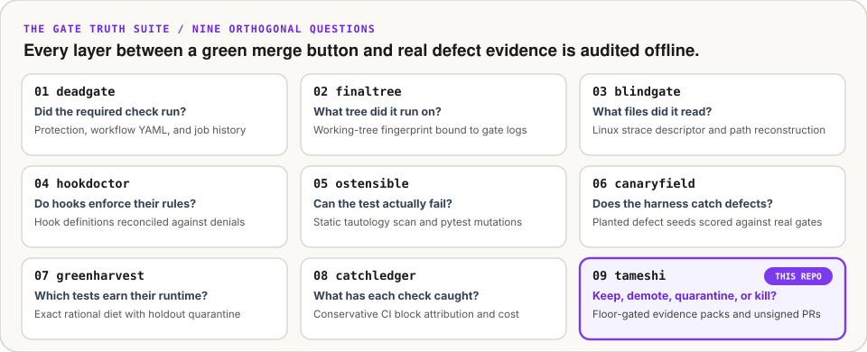

# tameshi Documentation

Tameshi judges checks by assembling `catchledger` scorecards, `canaryfield` planted-defect results, `blindgate` blindness traces, and optional `tameshi-decision/1` recommendations into one validated evidence pack per check, enforcing a mandatory 30-defect and 14-day evidence floor, and generating unsigned lifecycle rulings for human sign-off.

  <picture>
    <source media="(prefers-color-scheme: dark)" srcset="https://raw.githubusercontent.com/david-engelmann/tameshi/main/docs/media/how-it-works-dark.svg">
    
  </picture>

## Handbook Contents

- [Operator Guide](GUIDE.md) Step-by-step installation from GitHub, all four CLI doors, floor accounting, human sign-off workflow, and GitHub Actions verification.
- [Architecture](ARCHITECTURE.md) Multi-source pack assembly, 30-defect and 14-day floor evaluation, unsigned ruling invariants, parser bounds, and Gate Truth suite boundaries.
- [Wire Formats](FORMATS.md) Deterministic JSON and Markdown schemas across `tameshi-pack/1`, `tameshi-pack/2`, `tameshi-decision/1`, and `tameshi-ruling/1`.
- [Comparison](COMPARISON.md) Technical comparison against static branch-protection policies, ad-hoc check deletion, PR verdict tools (`verdictloop`), and sibling Gate Truth tools.
- [FAQ](FAQ.md) Direct answers to common installation, floor-shortfall, human-signature, and `kill` ruling questions.
- [Changelog](../CHANGELOG.md) Release milestone summaries.
- [Security Policy](../SECURITY.md) Execution model and private vulnerability reporting.
- [Contributing](../CONTRIBUTING.md) Contract-first development rules and exact-final-head local gates.

  <picture>
    <source media="(prefers-color-scheme: dark)" srcset="https://raw.githubusercontent.com/david-engelmann/tameshi/main/docs/media/gate-truth-arc-dark.svg">
    
  </picture>

